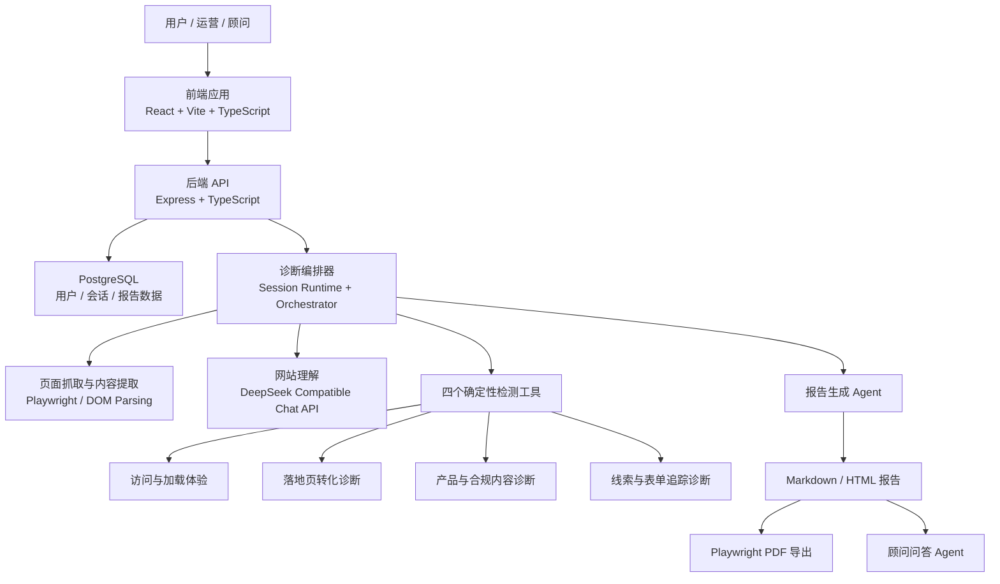
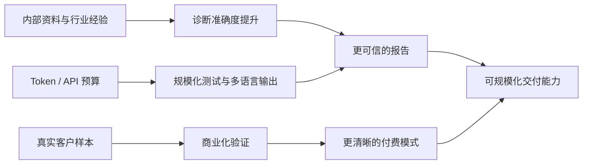

# 跨境出海诊断平台正式方案汇报

## 1. 项目概述

**跨境出海诊断平台**面向准备出海或正在进行海外获客的企业，提供基于网站 URL 和目标市场的自动化诊断能力。平台通过自动化页面检测、跨境业务规则判断和大模型报告生成，帮助企业快速识别海外访问体验、落地页转化、产品信任内容和线索追踪方面的问题，并输出可执行的优化建议。

项目当前的核心目标不是替代人工顾问，而是将跨境网站诊断中高频、标准化、可规则化的部分产品化，形成一个可快速初筛、可持续复用、可沉淀行业知识的智能诊断工具。

### 一句话定位

用户输入网站 URL 和目标市场后，平台自动生成一份跨境出海诊断报告，帮助企业发现影响海外获客转化的关键问题，并给出可落地的整改方向。

---

## 2. 产品价值

### 2.1 面向业务侧的价值

- **降低诊断门槛**：非技术用户也可以快速了解网站在海外市场的主要问题。
- **提升顾问效率**：将基础检查自动化，人工顾问可以把时间放在高价值策略判断上。
- **缩短优化周期**：报告直接给出问题影响、修复建议、验证方式和优先级。
- **沉淀行业方法论**：把跨境建站、广告承接、询盘转化和合规内容经验沉淀为可复用规则。

### 2.2 面向管理侧的价值

- **可作为跨境服务入口**：用低门槛诊断承接潜在客户，后续转化为建站、广告、SEO、数据追踪等服务。
- **可支撑规模化交付**：同一套诊断流程可应用于多个客户、多个行业、多个目标市场。
- **可形成数据资产**：随着诊断样本积累，可以沉淀行业基准、常见问题库和优化模板。
- **可探索商业化模式**：支持按次诊断、订阅、批量诊断、API 调用、定制报告等付费方向。

---

## 3. 产品流程设计

### 3.1 用户使用流程

### 3.2 核心诊断模块

| 模块 | 关注问题 | 业务意义 |
| --- | --- | --- |
| 访问与加载体验 | CDN、加载速度、协议、缓存、图片优化 | 降低海外访问等待时间，减少广告流量跳出 |
| 落地页转化诊断 | 首屏表达、CTA、移动端、表单入口 | 提高访问用户转化为询盘或注册的概率 |
| 产品与合规内容诊断 | 产品说明、参数、认证、案例、FAQ、信任背书 | 提升海外买家的理解和信任 |
| 线索与表单追踪诊断 | 表单字段、追踪代码、转化事件、数据采集 | 确保投放和销售团队能追踪线索质量 |

---

## 4. 技术方案

### 4.1 总体架构

当前技术方案采用 **LLM + 自动化检测工具编排** 的方式。确定性工具负责事实检测，大模型负责业务理解、报告生成和顾问问答，后端负责会话、数据和报告管理，前端负责诊断工作台与报告交互。

### 4.2 技术链路说明

1. **前端交互层**
   - 提供首页输入、诊断过程页、网站预览、报告展示、顾问问答和报告下载能力。
   - 使用左右分屏方式展示网站与诊断过程，降低用户对“后台正在做什么”的不确定感。

2. **后端服务层**
   - 管理诊断会话、用户状态、报告内容、模块结果和导出接口。
   - 通过 Prisma 连接 PostgreSQL，为后续诊断历史、运营后台和商业化能力提供数据基础。

3. **诊断编排层**
   - 先抓取目标网站内容，再调用模型进行网站定位理解。
   - 并行执行四个自动化检测工具，获得结构化检测结果。
   - 将目标市场、网站理解和工具结果传入报告生成 Agent，输出完整诊断报告。

4. **模型能力层**
   - 当前模型主要承担三类任务：网站业务理解、诊断报告生成、顾问问答。
   - 四个检测模块目前不是完全独立的 autonomous child agents，而是确定性自动化检测工具，这样更稳定、可控、可复现。

5. **报告导出层**
   - 报告正文统一生成 Markdown 和 HTML。
   - PDF 通过 Playwright 服务端渲染生成，避免把前端工作台、网站预览或聊天抽屉导入正式报告。

---

## 5. 当前阶段成果

| 成果 | 说明 |
| --- | --- |
| ✅ 核心诊断流程跑通 | 已支持输入网站和目标市场后创建诊断会话，并执行网站理解、模块检测和报告生成 |
| ✅ 四模块诊断框架成型 | 已覆盖访问体验、落地页转化、产品内容、表单追踪四个跨境关键维度 |
| ✅ 报告生成能力可用 | 已能生成面向业务负责人的结构化诊断报告 |
| ✅ PDF / HTML 导出可用 | 报告可独立下载和分发，适合内部讨论或客户沟通 |
| ✅ 顾问问答闭环初步具备 | 用户可围绕报告继续追问具体优化建议 |
| ✅ 后续扩展基础具备 | 前后端、数据库、Agent 编排、部署配置已形成基础工程框架 |

---

## 6. 下一阶段优化方向

### 6.1 产品闭环优化

- 建设诊断历史记录，支持用户查看、下载和重新打开历史报告。
- 增加重新诊断和优化前后对比能力，让平台从单次工具升级为持续跟踪工具。
- 建设报告分享链接，支持客户内部团队协作，但需要先明确隐私和权限策略。

### 6.2 用户增长与留存

- 完善邮箱登录、微信登录和账号绑定能力。
- 增加诊断完成邮件通知，自动发送报告摘要和下载链接。
- 建设用户中心，让用户可以管理历史诊断、报告文件和账号信息。

### 6.3 国际化与对外展示

- 优先完善英文界面和英文报告。
- 后续扩展日文、韩文、西班牙文等重点市场语言。
- 支持根据目标市场生成更本地化的建议，例如隐私合规、支付习惯、页面信任表达和客服触达方式。

### 6.4 诊断准确度提升

- 接入全球测速节点或第三方性能 API，提升访问体验模块的可信度。
- 沉淀行业模板库，按 B2B、DTC、SaaS、物流、教育、医疗等行业输出差异化建议。
- 引入真实客户样本进行校验，持续修正评分规则和报告表达。

### 6.5 运营与商业化能力

- 建设管理员后台，查看诊断次数、用户来源、目标市场分布、模块失败率和平均耗时。
- 探索批量诊断和 API 调用能力，服务代理商、服务商和内部业务团队。
- 结合成本测算，设计免费版、高级版、按次付费或订阅模式。

---

## 7. 资源支持申请

为了让项目从“可演示”进入“可规模化验证”，建议下一阶段重点申请以下资源。

| 资源类型 | 具体内容 | 用途 |
| --- | --- | --- |
| 📘 跨境内部资料 | 客户案例、常见网站问题、广告落地页经验、询盘质量判断标准 | 转化为诊断规则和报告建议 |
| 🧩 行业模板库 | B2B、DTC、SaaS 等行业优秀页面、表单、FAQ、信任背书样例 | 提升报告专业度和行业适配度 |
| 🌍 目标市场资料 | 美国、欧盟、日本、韩国、东南亚等市场规则和用户习惯 | 支持更本地化的诊断建议 |
| 🔑 Token / 模型 API 额度 | DeepSeek 或兼容模型的稳定调用预算 | 支撑报告生成、顾问问答、多语言和批量测试 |
| 📡 第三方数据 API | 全球测速、页面性能、IP 地理位置、邮件服务、教程元数据 | 提升诊断数据可信度和产品闭环 |
| 🧪 真实客户样本 | 不同行业、不同建站平台、不同目标市场的网站样本 | 验证诊断准确度和报告可用性 |
| 📈 运营与商业化支持 | 试点客户、反馈收集、定价策略、服务承接路径 | 验证产品价值和商业模式 |

### 资源投入与产出关系

---

## 8. 风险与应对

| 风险 | 表现 | 应对方案 |
| --- | --- | --- |
| 诊断结果过于通用 | 报告像通用建议，缺乏行业深度 | 引入内部案例、行业模板和目标市场资料 |
| 模型调用成本上升 | 多语言、问答和批量诊断消耗 Token | 设置调用限额、缓存报告结果、区分免费与高级功能 |
| 访问检测不够准确 | 单一节点无法代表目标市场体验 | 接入全球测速 API 或自建关键市场测速节点 |
| 客户数据安全问题 | 报告包含客户网站内容和截图 | 明确数据使用范围、权限控制和报告分享策略 |
| 商业化路径不清晰 | 功能做多但不知道谁付费 | 先用真实客户试点验证按次、订阅和服务转化模式 |

---

## 9. 阶段性里程碑建议

### 第一阶段：产品闭环补齐

- 完成诊断历史、报告复用、登录闭环和邮件通知。
- 目标是让用户完成诊断后能回来、能复用、能继续跟进。

### 第二阶段：诊断能力增强

- 接入全球测速能力。
- 建设行业模板库和目标市场规则库。
- 用真实客户样本校验诊断结果。

### 第三阶段：商业化验证

- 建设管理员后台。
- 开放批量诊断或 API 调用试点。
- 验证按次诊断、订阅、高级报告或顾问服务转化模式。

---

## 10. 汇报结论

跨境出海诊断平台当前已经具备从网站理解、自动化检测、报告生成到顾问问答的基础闭环。它的核心价值，是把跨境网站诊断中可标准化、可自动化的部分产品化，为业务团队提供更快的初筛能力，也为后续顾问服务和商业化转化提供入口。

下一阶段的重点不是单纯增加功能，而是围绕三个目标投入资源：

- **提升诊断准确度**：通过内部资料、行业模板和目标市场规则，让报告更专业。
- **提升规模化交付能力**：通过历史记录、多语言、邮件通知、后台和 API 能力，让平台能服务更多用户。
- **提升商业化验证速度**：通过真实客户样本、运营支持和付费路径设计，验证平台是否能从工具走向业务增长入口。

如果能获得跨境内部资料、Token/API 额度、第三方数据接口和真实客户试点资源，项目就可以从当前的可演示版本，推进到可试点、可复用、可商业化验证的下一阶段。
